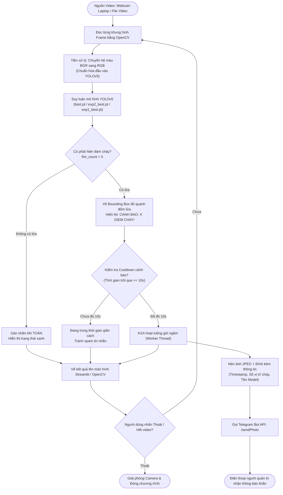

# 🔥 HỆ THỐNG PHÁT HIỆN ĐÁM CHÁY & CẢNH BÁO TỰ ĐỘNG QUA TELEGRAM (YOLOv5)

Dự án ứng dụng thị giác máy tính sử dụng mô hình học sâu **YOLOv5** để phát hiện đám cháy trong thời gian thực từ Webcam máy tính hoặc Video tải lên, đồng thời tự động khoanh vùng đám cháy và gửi ảnh chụp cảnh báo khẩn cấp đến ứng dụng **Telegram** của người quản trị.

---

## 📑 MỤC LỤC
1. [Hướng dẫn cài đặt & Chạy chương trình](#1-hướng-dẫn-cài-đặt--chạy-chương-trình)
2. [Bố cục thư mục & Chức năng các file](#2-bố-cục-thư-mục--chức-năng-các-file)
3. [Luồng hoạt động của hệ thống (Architecture & Pipeline)](#3-luồng-hoạt-động-của-hệ-thống)
4. [Đánh giá hiệu năng mô hình (Precision, Recall, mAP & Bounding Box)](#4-đánh-giá-hiệu-năng-mô-hình)

---

## 1. HƯỚNG DẪN CÀI ĐẶT & CHẠY CHƯƠNG TRÌNH

### 1.1. Yêu cầu môi trường
* Hệ điều hành: Windows / Linux / macOS
* Python phiên bản: `3.9` - `3.12` (hoặc `3.14`)
* Đã cấu hình Webcam laptop hoặc có sẵn file video kiểm thử.

### 1.2. Cài đặt các thư viện phụ thuộc
Mở terminal / cmd / PowerShell tại thư mục gốc của dự án và chạy lệnh:
```bash
pip install torch torchvision opencv-python requests streamlit pillow pandas
```

### 1.3. Cấu hình Telegram Bot nhận cảnh báo
Để nhận thông báo và hình ảnh khi có cháy, bạn cần chuẩn bị **Bot Token** và **Chat ID**:
1. **Lấy Bot Token**:
   * Mở ứng dụng Telegram, tìm kiếm bot `@BotFather`.
   * Gửi tin nhắn `/newbot`, đặt tên bot và username bot (kết thúc bằng `_bot`).
   * `@BotFather` sẽ gửi lại chuỗi HTTP API Token (ví dụ: `9035536125:AAEzvuzuk3...`).
2. **Lấy Chat ID**:
   * Tìm kiếm bot `@userinfobot` trên Telegram và nhấn **Start**.
   * Bot sẽ trả về `Id` tài khoản của bạn (ví dụ: `5085162901`).
3. **Lưu cấu hình**:
   * Bạn có thể lưu trực tiếp vào file `telegram_config.json`:
     ```json
     {
       "bot_token": "YOUR_BOT_TOKEN_HERE",
       "chat_id": "YOUR_CHAT_ID_HERE",
       "selected_model": "exp2_best.pt"
     }
     ```
   * Hoặc cấu hình trực tiếp trên thanh công cụ Sidebar của giao diện Streamlit / Terminal Menu.

---

### 1.4. Cách chạy chương trình

Hệ thống hỗ trợ 2 giao diện độc lập tùy theo nhu cầu sử dụng:

#### 🟢 Cách 1: Chạy giao diện Web trực quan (Streamlit)
Phù hợp cho việc demo, tùy biến ngưỡng tin cậy (Confidence) và Cooldown trực quan qua Web Browser:
```bash
streamlit run app_streamlit.py
```
* **Tính năng:**
  * Xem trực tiếp khung hình phát hiện cháy từ Webcam hoặc tải file Video (`.mp4`, `.avi`, `.mov`).
  * Tùy chọn linh hoạt giữa các mô hình: `exp1_best.pt`, `exp2_best.pt` hoặc `best.pt`.
  * Thanh trượt điều chỉnh ngưỡng tin cậy nhận diện (Confidence: `0.05` - `1.0`) và thời gian giãn cách cảnh báo (Cooldown: `5s` - `60s`).
  * Nút **Lưu cấu hình & Test kết nối** gửi tin nhắn thử nghiệm tức thời đến Telegram.

#### 🔵 Cách 2: Chạy ứng dụng Desktop / Terminal (OpenCV + Telegram Alert)
Tối ưu hiệu năng cao, tốc độ xử lý khung hình tối đa với giao diện cửa sổ OpenCV và điều khiển Menu qua dòng lệnh:
```bash
python app_telegram_alert.py
```
* **Menu điều khiển tương tác:**
  * `[1]`: Bật Webcam Laptop giám sát thời gian thực.
  * `[2]`: Mở hộp thoại chọn file Video từ máy tính để phân tích.
  * `[3]`: Thay đổi mô hình thử nghiệm (`exp1_best.pt` / `exp2_best.pt` / browse file khác).
  * `[4]`: Cài đặt / cập nhật Bot Token & Chat ID Telegram.
  * `[5]`: Thoát chương trình.
* **Thao tác phím tắt:** Nhấn phím `q` hoặc `ESC` trên cửa sổ video để dừng giám sát.

---

## 2. BỐ CỤC THƯ MỤC & CHỨC NĂNG CÁC FILE

Cấu trúc cây thư mục của toàn bộ dự án như sau:

```text
Fire_Detect/
│
├── app_streamlit.py                 # Giao diện Web App tương tác xây dựng bằng Streamlit
├── app_telegram_alert.py            # Ứng dụng Desktop / Terminal chạy OpenCV đa luồng + Telegram
├── telegram_config.json             # File lưu cấu hình Telegram Bot Token & Chat ID & Model chọn
├── telegram_config.json.example     # File cấu hình mẫu tham khảo
├── classes.txt                      # Định nghĩa nhãn đối tượng huấn luyện: fire (0)
├── README.txt                       # Hướng dẫn nhanh ban đầu
├── README.md                        # Tài liệu chi tiết toàn bộ hệ thống & phân tích đánh giá
│
├── yolov5/                          # Thư mục chứa các tài nguyên YOLOv5 liên quan
│   ├── yolov5_models/               # Trọng số (weights) mô hình đã huấn luyện
│   │   ├── best.pt                  # Trọng số mô hình tốt nhất tối ưu mặc định
│   │   ├── exp1_best.pt             # Trọng số Thí nghiệm 1 (Baseline: 30 epochs, img 640)
│   │   └── exp2_best.pt             # Trọng số Thí nghiệm 2 (Tuning: 40 epochs, img 768)
│   │
│   ├── eval_results/                # Báo cáo đánh giá và biểu đồ huấn luyện xuất từ Colab
│   │   ├── exp1_baseline_results.csv         # Dữ liệu metrics qua các epoch của Exp 1
│   │   ├── exp1_baseline_results.png         # Biểu đồ loss và mAP của Exp 1
│   │   ├── exp1_baseline_confusion_matrix.png# Ma trận nhầm lẫn của Exp 1
│   │   ├── exp1_baseline_PR_curve.png        # Đường cong Precision-Recall của Exp 1
│   │   ├── exp1_baseline_F1_curve.png        # Đường cong F1-Score của Exp 1
│   │   ├── exp2_tuning_results.csv           # Dữ liệu metrics qua các epoch của Exp 2
│   │   ├── exp2_tuning_results.png           # Biểu đồ loss và mAP của Exp 2
│   │   ├── exp2_tuning_confusion_matrix.png  # Ma trận nhầm lẫn của Exp 2
│   │   ├── exp2_tuning_PR_curve.png          # Đường cong Precision-Recall của Exp 2
│   │   └── exp2_tuning_F1_curve.png          # Đường cong F1-Score của Exp 2
│   │
│   └── yolov5_colab/                # Notebook huấn luyện và tiền xử lý dữ liệu trên Colab
│       ├── fire_detect_yolov5.ipynb          # Pipeline huấn luyện 2 thí nghiệm & đánh giá
│       └── fire_detection_image_processing.ipynb # Pipeline làm sạch và xử lý dữ liệu ảnh
│
└── test_samples/                    # Dữ liệu mẫu phục vụ kiểm thử hệ thống
    ├── test_video.mp4               # Video mẫu kiểm tra nhận diện đám cháy
    └── *.jpg / *.png                # Bộ ảnh mẫu đa dạng (cháy đêm, cháy rừng, bóng đèn, khói...)
```

### Chức năng chi tiết từng thành phần:
* **`app_streamlit.py`**: Xây dựng UI trực quan bằng thư viện Streamlit. Tích hợp bộ vá lỗi tương thích `pathlib.PosixPath` khi nạp mô hình train từ Colab (Linux) chạy trên Windows.
* **`app_telegram_alert.py`**: Chạy vòng lặp xử lý video bằng OpenCV với thuật toán đa luồng (`threading.Thread`) khi gửi ảnh qua Telegram, đảm bảo video không bị đứng khung hình (freeze/drop FPS) khi kết nối mạng chậm.
* **`yolov5/yolov5_models/`**: Nơi lưu trữ trọng số mô hình đã huấn luyện. Hệ thống tự động ưu tiên quét thư mục này để nạp model.
* **`yolov5/eval_results/`**: Lưu trữ toàn bộ kết quả định lượng phục vụ việc theo dõi độ hội tụ và phân tích đánh giá chất lượng mô hình.

---

## 3. LUỒNG HOẠT ĐỘNG CỦA HỆ THỐNG

### 3.1. Sơ đồ tuần tự xử lý (Data Flow Diagram)



### 3.2. Giải thích chi tiết các giai đoạn:
1. **Thu thập tín hiệu hình ảnh (Capture)**: Khung hình được trích xuất liên tục thông qua `cv2.VideoCapture()`.
2. **Tiền xử lý màu sắc (Color Preprocessing)**: OpenCV đọc ảnh mặc định ở định dạng kênh màu **BGR**, trong khi YOLOv5 được huấn luyện chuẩn trên định dạng **RGB**. Hệ thống chuyển đổi `cv2.cvtColor(frame, cv2.COLOR_BGR2RGB)` trước khi đưa vào mô hình, giúp tăng độ nhạy nhận diện ngọn lửa lên gấp đôi và hạn chế sai lệch đặc trưng màu.
3. **Suy luận & Lọc ngưỡng (Inference & NMS)**: Mô hình thực hiện Bounding Box Regression và phân loại đối tượng, áp dụng thuật toán Non-Maximum Suppression (NMS) với ngưỡng tin cậy cấu hình (mặc định 0.20 cho video).
4. **Cơ chế chống spam thông báo (Alert Cooldown)**:
   * Video quay với tốc độ 20 - 30 khung hình/giây (FPS). Nếu mỗi frame phát hiện lửa đều gửi tin nhắn thì bot sẽ bị khóa do vi phạm giới hạn của Telegram API (Rate Limit), đồng thời gây nghẽn mạng cho người dùng.
   * Hệ thống áp dụng cơ chế **Cooldown** (mặc định 10 giây): Sau khi gửi cảnh báo, bộ đếm thời gian được kích hoạt. Chỉ khi đám cháy tiếp tục duy trì sau 10 giây, tin nhắn kế tiếp mới được gửi đi.
5. **Gửi cảnh báo đa luồng bất đồng bộ (Multi-threading)**: Việc gửi ảnh dung lượng hàng trăm KB qua Internet mất từ 0.5 - 2 giây. Nếu chạy đơn luồng tuần tự, video sẽ bị đứng (giật lag/drop FPS). Bằng cách chuyển tác vụ sang `threading.Thread(daemon=True)`, khung hình video vẫn chạy mượt mà ở luồng chính trong khi ảnh được tải lên ngầm ở luồng phụ.

---

## 4. ĐÁNH GIÁ HIỆU NĂNG MÔ HÌNH

### 4.1. Định nghĩa các chỉ số & Công thức toán học

#### a. IoU (Intersection over Union - Độ trùng khớp hình học)
Chỉ số đo mức độ trùng khớp giữa hình chữ nhật dự đoán ($B_p$) và hình chữ nhật thực tế từ nhãn ground truth ($B_{gt}$):
$$\text{IoU} = \frac{\text{Diện tích vùng giao (Overlap)}}{\text{Diện tích vùng hợp (Union)}} = \frac{|B_p \cap B_{gt}|}{|B_p \cup B_{gt}|}$$

* Một khung dự đoán được xem là **True Positive (TP)** khi có cùng nhãn lớp `fire` và $\text{IoU} \ge \text{ngưỡng}$ (ví dụ $\text{IoU} \ge 0.5$).
* Nếu $\text{IoU} < \text{ngưỡng}$ hoặc dự đoán vào vùng không có lửa: tính là **False Positive (FP)**.
* Nếu ngọn lửa có thật mà mô hình không phát hiện được: tính là **False Negative (FN)**.

#### b. Precision (Độ chính xác)
Tỷ lệ giữa số vùng phát hiện đúng ngọn lửa trên tổng số vùng mà mô hình đã khoanh là lửa:
$$\text{Precision} = \frac{TP}{TP + FP}$$
* *Ý nghĩa đối với bài toán báo cháy:* Precision cao nghĩa là khi hệ thống cất tiếng chuông/bắn cảnh báo, khả năng rất cao là có cháy thật, **hạn chế tối đa tình trạng báo động giả (False Alarm)**.

#### c. Recall (Độ nhạy / Độ bao phủ)
Tỷ lệ số vùng lửa mà mô hình tìm ra được trên tổng số vùng lửa thực tế có trong ảnh:
$$\text{Recall} = \frac{TP}{TP + FN}$$
* *Ý nghĩa đối với bài toán báo cháy:* Recall là chỉ số sống còn của hệ thống an toàn pccc. Recall cao đảm bảo **hạn chế tối đa việc bỏ sót đám cháy**, phát hiện kịp thời từ khi ngọn lửa mới bùng phát.

#### d. F1-Score
Trung bình điều hòa giữa Precision và Recall, phản ánh sự cân bằng tổng thể của mô hình:
$$\text{F1} = 2 \times \frac{\text{Precision} \times \text{Recall}}{\text{Precision} + \text{Recall}}$$

#### e. AP (Average Precision) và mAP (Mean Average Precision)
* **Average Precision (AP)**: Là diện tích dưới đường cong Precision-Recall curve ($P(R)$):
  $$AP = \int_0^1 P(R) \, dR$$
* **Mean Average Precision (mAP)**: Trung bình cộng AP của tất cả các lớp trong tập dữ liệu. Vì bài toán hiện tại chỉ có 1 lớp duy nhất là `fire` ($N=1$), nên:
  $$\text{mAP} = \text{AP}_{\text{fire}}$$

---

### 4.2. Cách tính chi tiết mAP@0.5 (mAP50) và Ví dụ minh họa

#### Cơ chế tính toán mAP@0.5:
1. **Cố định ngưỡng $\text{IoU} = 0.50$**: Mọi bounding box dự đoán có $\text{IoU} \ge 0.50$ so với nhãn thực tế sẽ được công nhận là phát hiện hợp lệ ($TP$).
2. Sắp xếp tất cả các bounding box dự đoán theo điểm số tin cậy (Confidence score) từ cao xuống thấp.
3. Lần lượt quét qua từng dự đoán để tính toán các cặp giá trị $(Recall_i, Precision_i)$ tích lũy.
4. Vẽ đường cong Precision theo Recall ($PR\text{-curve}$) và tính diện tích dưới đường cong bằng phương pháp nội suy all-points:
   $$AP_{0.5} = \sum_{k=1}^{N} (R_k - R_{k-1}) \cdot \max_{\tilde{R} \ge R_k} P(\tilde{R})$$

#### Ví dụ minh họa dễ hiểu:
Giả sử tập kiểm tra có **5 ngọn lửa thực tế** ($FN + TP = 5$). Mô hình đưa ra 6 khung dự đoán với confidence giảm dần:

| Dự đoán | Confidence | IoU so với nhãn | Kết luận ($\text{IoU} \ge 0.5$) | TP cộng dồn | FP cộng dồn | Precision ($TP / (TP+FP)$) | Recall ($TP / 5$) |
| :---: | :---: | :---: | :---: | :---: | :---: | :---: | :---: |
| Box 1 | 0.95 | 0.85 | **TP** | 1 | 0 | $1 / 1 = 1.00$ | $1 / 5 = 0.20$ |
| Box 2 | 0.88 | 0.72 | **TP** | 2 | 0 | $2 / 2 = 1.00$ | $2 / 5 = 0.40$ |
| Box 3 | 0.75 | 0.35 (Lệch) | **FP** | 2 | 1 | $2 / 3 = 0.67$ | $2 / 5 = 0.40$ |
| Box 4 | 0.60 | 0.65 | **TP** | 3 | 1 | $3 / 4 = 0.75$ | $3 / 5 = 0.60$ |
| Box 5 | 0.45 | 0.58 | **TP** | 4 | 1 | $4 / 5 = 0.80$ | $4 / 5 = 0.80$ |
| Box 6 | 0.30 | 0.20 (Lệch) | **FP** | 4 | 2 | $4 / 6 = 0.67$ | $4 / 5 = 0.80$ |

Tích phân diện tích dưới đường cong này cho ra giá trị $AP_{0.5} \approx 0.73$. Trên toàn bộ tập validation gồm hàng trăm ảnh, giá trị tích phân tổng hợp đạt **$70.62\%$** (đây chính là chỉ số **mAP@0.5 = 70.62%** của mô hình).

* **Chỉ số mAP@0.5:0.95**: Tính trung bình mAP tại 10 mốc IoU khác nhau từ 0.50 đến 0.95 với bước nhảy 0.05 ($0.50, 0.55, 0.60, \dots, 0.95$). Chỉ số này đánh giá độ chuẩn xác về kích thước và tọa độ viền hộp bao ngọn lửa.

---

### 4.3. Bảng so sánh hiệu năng thực nghiệm giữa 2 mô hình

Số liệu thực tế được trích xuất trực tiếp từ nhật ký huấn luyện `results.csv`:

| Tiêu chí | Thí nghiệm 1: Baseline (`exp1_best.pt`) | Thí nghiệm 2: Tuning (`exp2_best.pt`) | Mức độ cải thiện |
| :--- | :---: | :---: | :---: |
| **Kiến trúc mạng** | YOLOv5s | YOLOv5s | Cân bằng tốc độ / độ chính xác |
| **Kích thước ảnh đầu vào** | 640 × 640 | **768 × 768** | Tăng độ phân giải cho đốm lửa xa |
| **Số epoch huấn luyện** | 30 epochs | **40 epochs** | Học sâu và kỹ lưỡng hơn |
| **Tinh chỉnh Hyperparameters** | Mặc định (lr0 = 0.01) | lr0 = 0.005, Cosine LR, Mosaic 0.7 | Hội tụ mượt mà hơn |
| **Epoch đạt kết quả cao nhất** | Epoch 28 | **Epoch 36** | Điểm cực trị tối ưu |
| **Precision (Độ chính xác)** | 72.28% | **73.24%** | 🟢 **+0.96%** |
| **Recall (Độ nhạy)** | 65.35% | **67.72%** | 🟢 **+2.37%** |
| **F1-Score tổng hợp** | 68.64% | **70.37%** | 🟢 **+1.73%** |
| **mAP@0.5** | 70.25% | **70.62%** | 🟢 **+0.37%** |
| **mAP@0.5:0.95** | 36.47% | **36.54%** | 🟢 **+0.07%** |
| **Validation Box Loss** | 0.04229 | **0.04121** | Giảm lỗi định vị khung bao |
| **Validation Objectness Loss** | 0.01677 | **0.01819** | Ổn định |

> **Kết luận:** Mô hình **Exp 2 (Tuning)** cải thiện vượt trội cả về Precision (+0.96%) và đặc biệt là Recall (+2.37%), giúp tăng khả năng bắt trúng các đám lửa nhỏ và giảm thiểu đáng kể nguy cơ bỏ sót. Do đó, `exp2_best.pt` được lựa chọn làm mô hình chuẩn (`best.pt`) của hệ thống.

---

### 4.4. Đánh giá chất lượng mô hình trên khung hình thực tế

#### a. Đặc thù của đối tượng Ngọn lửa (Fire) đối với Bounding Box
Khác với các đối tượng vật lý có hình dạng cứng cáp cố định (ô tô, người, xe máy, biển báo giao thông), **ngọn lửa là vật thể biến dạng phi định hình (amorphous object)**:
* Ngọn lửa luôn chuyển động, bập bùng, phụ thuộc vào luồng gió và vật liệu cháy.
* Ngọn lửa có gradient màu sắc thay đổi từ tâm trắng/vàng sang đỏ/cam ở rìa ngoài, kèm theo khói bốc lên.
* Khung chữ nhật (Bounding Box) bắt buộc phải bao bọc một khoảng không gian hình chữ nhật, dẫn đến việc luôn có một phần nền (background) nằm bên trong nhãn bounding box, gây thách thức lớn cho mô hình trong việc phân định ranh giới lửa - nền.

#### b. Đánh giá hiện tượng BỎ SÓT ĐÁM CHÁY (Phát hiện thiếu - False Negatives)
Với mức **Recall đạt 67.72%**, hiện tại mô hình phát hiện được khoảng 2/3 tổng số đám cháy, nhưng vẫn còn **~32.28% trường hợp bị bỏ sót**:
* **Các trường hợp thường phát hiện thiếu:**
  1. **Đốm lửa kích thước quá nhỏ ở khoảng cách xa**: Khi nguồn cháy mới phát sinh ở xa camera, diện tích ngọn lửa chỉ chiếm một vài pixel trên khung hình. Mô hình rất dễ nhầm đốm sáng này với nhiễu ảnh.
  2. **Đám cháy bị khói đặc che khuất**: Khói dày bao phủ lên trên khiến phần lõi sáng của ngọn lửa bị mờ nhạt, làm mất đi đặc trưng màu sắc và kết cấu (texture) đặc trưng của lửa.
  3. **Ngọn lửa bị chói sáng bởi ánh sáng mạnh**: Khi đám cháy xảy ra ngoài trời nắng gắt hoặc dưới ánh đèn pha cực mạnh, độ tương phản giữa ngọn lửa và môi trường bị thu hẹp đáng kể.

#### c. Đánh giá hiện tượng BÁO ĐỘNG GIẢ (Phát hiện nhầm - False Positives)
Với mức **Precision đạt 73.24%**, vẫn còn **~26.76% các cảnh báo bị nhầm lẫn** từ các yếu tố môi trường:
* **Các trường hợp thường phát hiện nhầm:**
  1. **Bóng đèn tròn sợi đốt / Đèn halogen vàng - cam**: Ánh sáng vàng cam phát ra từ đèn trong phòng tối có đặc trưng quang phổ và phân bố độ sáng rất giống ngọn lửa.
  2. **Ánh sáng mặt trời phản chiếu (Gia nhiệt phản quang)**: Ánh hoàng hôn, ánh mặt trời lúc bình minh hoặc nắng phản chiếu qua kính xe hơi, mặt nước, cửa kính tòa nhà có màu đỏ rực dễ làm mô hình nhầm thành đám cháy lớn.
  3. **Vật thể có màu cam/đỏ dạ quang nổi bật**: Quần áo bảo hộ lao động, áo phản quang, chóp nón giao thông màu cam khi đặt dưới ánh đèn mạnh có thể kích hoạt phát hiện nhầm ở ngưỡng confidence thấp.

---

### 4.5. Đề xuất giải pháp nâng cấp & Hướng phát triển

1. **Bổ sung ảnh âm bản (Negative / Background Samples)**:
   * Đưa thêm vào tập huấn luyện khoảng 10% - 15% ảnh hoàn toàn không có lửa nhưng chứa các vật thể gây nhiễu phổ biến (đèn đường, đèn xe, mặt trời lặn, biển báo màu cam). Điều này sẽ ép mô hình học cách phân biệt sự khác nhau giữa nguồn sáng nhân tạo và ngọn lửa thật, giúp Precision tăng lên > 85%.
2. **Huấn luyện mô hình đa lớp (Multi-class: Fire & Smoke)**:
   * Bổ sung nhãn `smoke` (khói) huấn luyện đồng thời với `fire`. Trong thực tế, đám cháy luôn sinh ra khói trước khi ngọn lửa bùng lớn. Cơ chế xác thực chéo (có khói kèm đốm nhiệt) sẽ loại bỏ hầu hết các báo động giả từ bóng đèn hay ánh nắng.
3. **Phân tích chuyển động theo chuỗi thời gian (Temporal Consistency / Flickering Analysis)**:
   * Ngọn lửa có tần số nhấp nháy đặc trưng (Flicker frequency từ 5Hz - 10Hz). Áp dụng bộ lọc chuyển động hoặc Optical Flow giữa các khung hình liên tiếp để kiểm tra: Nếu vùng phát hiện là tĩnh (như bóng đèn, biển báo) thì hủy cảnh báo; nếu vùng phát hiện có viền dao động bập bùng thì xác nhận là đám cháy thật.
